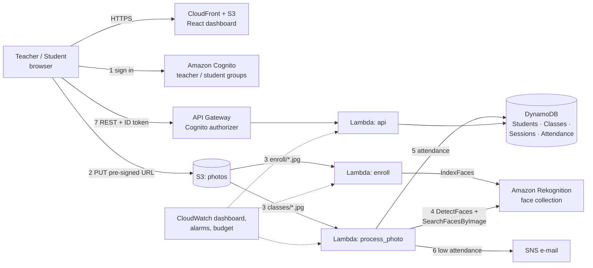

# CloudAttend: serverless face-recognition attendance on AWS

UCS531 Cloud Computing project. A teacher uploads a classroom photo from the browser, and every
enrolled student whose face is in it is marked present. Students below the attendance threshold
get an e-mail. Everything is serverless and defined in AWS CDK, so `npm run deploy` builds and
deploys the whole system.

## Architecture



1. The user signs in with Cognito. The ID token carries the role (`teacher`/`student`) and, for students, `custom:studentId`.
2. The dashboard gets a pre-signed URL from the API and uploads the photo straight to S3.
3. The S3 upload event triggers a Lambda: `enroll/<studentId>.jpg` goes to **enroll**, `classes/<classId>/<date>/…jpg` goes to **process_photo**.
4. **process_photo** fixes the photo's EXIF rotation and size, runs `DetectFaces`, crops each face, and runs `SearchFacesByImage`. Only matches on that class's roster count.
5. Present students are written to DynamoDB. Several photos for the same date are combined, so a big room can be covered in 2–3 shots.
6. After the last photo of a session, roster students who were absent **and** are below the threshold get one SNS e-mail for that session.
7. The dashboard reads reports through the REST API. See [docs/api.md](docs/api.md) for the full contract.

| Service | Used for |
|---|---|
| Lambda (Python 3.12, ARM) | `api`, `enroll`, `process_photo` |
| API Gateway (REST) | 14 routes, all behind a Cognito authorizer |
| S3 | photo storage (private, pre-signed URLs) and dashboard hosting (private, CloudFront OAC) |
| Rekognition | face collection, detection and search |
| DynamoDB (provisioned, always-free capacity) | Students, Classes, Sessions, Attendance (+ `by-student` GSI), Usage |
| Cognito | login, teacher/student groups, immutable `custom:studentId` |
| SNS | per-student low-attendance e-mails (filter policy), ops alarm e-mails |
| CloudFront | HTTPS CDN for the React app |
| CloudWatch | logs (2-week retention), dashboard, error alarms, custom face metrics (EMF) |
| AWS Budgets | zero-spend alert |
| IAM | least-privilege role per Lambda |
| AWS CDK (TypeScript) | all of the above as code |

## Repository layout

```
infra/                 AWS CDK app (stack: CloudAttendStack)
  lib/cloudattend-stack.ts
  lambda/api/          REST API router
  lambda/enroll/       index a student's reference face
  lambda/process_photo/ match a class photo, record attendance, alert
  lambda/tests/        pytest + moto unit tests
  test/                CDK assertion tests
web/                   React + Vite + TypeScript dashboard
scripts/               create-teacher.sh, write-local-config.sh
docs/api.md            REST API contract
```

## Prerequisites

- Node.js 20+ and npm
- Python 3.12 (used for the Lambda tests, and to bundle Pillow for Lambda without Docker)
- AWS CLI v2, signed in to the target account
- One-time per account/region: `cd infra && npx cdk bootstrap aws://<account>/ap-south-1`

## Deploy

```bash
cd infra
npm install
npm run deploy        # builds web/, then cdk deploy (≈10 min the first time, for CloudFront)
```

Settings live in `infra/cdk.json` → `context` (override with `-c key=value`):

| Key | Default | Meaning |
|---|---|---|
| `alertEmail` | – | ops alarms + budget e-mails (no budget or ops e-mail if unset) |
| `attendanceThreshold` | `75` | % below which a student gets an alert |
| `minSessionsForAlert` | `3` | no alerts until a class has this many sessions |
| `monthlyBudgetUsd` | `1` | zero-spend budget: e-mails on any actual charge of $0.01 or more |
| `rekognitionMonthlyCap` | `900` | max Rekognition calls per month per API group (free-tier guard) |
| `maxFacesPerPhoto` | `50` | only the N largest faces in a class photo are searched |

The stack outputs are `WebUrl` (dashboard), `ApiUrl`, `UserPoolId`, `UserPoolClientId`, `PhotosBucketName` and `DashboardUrl`.

After the first deploy:

1. **Confirm the ops e-mail.** SNS sends "AWS Notification – Subscription Confirmation" to `alertEmail`. Click the link.
2. **Create a teacher:** run `scripts/create-teacher.sh teacher@example.com`. Cognito e-mails a temporary password, and the teacher chooses a new one at first sign-in on `WebUrl`.

## Using it

1. **Teacher → Students:** add a student (ID, name, e-mail) and upload a clear photo of only that student. This also creates the student's login, and Cognito e-mails them a temporary password. The status changes to `INDEXED`, or tells you to retake the photo (`NO_FACE`, `MULTIPLE_FACES`).
2. **Teacher → Classes:** create a class and tick its students (the roster).
3. **Teacher → Take attendance:** pick the date and upload 1–3 classroom photos. Within seconds you see each photo with green (matched) and red (unknown) boxes, plus present and absent lists. Toggle anyone the camera missed.
4. **Reports:** per-class percentages (below-threshold rows highlighted) and per-session counts. Students sign in to see only their own attendance.
5. **Alerts:** after the first enrollment, each student gets an SNS "Subscription Confirmation" e-mail and must click it to receive low-attendance alerts.

## Local development

```bash
# backend tests
python3.12 -m venv local/.venv && local/.venv/bin/pip install pytest "moto[dynamodb,s3,sns,cognitoidp]" boto3 pillow
cd infra && npm run test:lambda        # Lambda unit tests (moto + fake Rekognition)
npm test                               # CDK assertion tests
npx cdk synth                          # CloudFormation template

# end-to-end smoke test against the deployed stack (temporary teacher, cleans up after itself;
# makes 1 Rekognition DetectFaces call; add --no-photo to skip it)
local/.venv/bin/python scripts/smoke_test.py

# demo data (DynamoDB only, $0): a fictional class with 8 students and 8 sessions of attendance
local/.venv/bin/python scripts/seed_demo.py --teacher you@example.com      # add --remove to delete
# face-recognition demo with public-domain NASA photos in local/demo-faces/ (Artemis II crew):
# enrolls 4 astronauts (~8 Rekognition calls), --verify runs a group photo, --remove also deletes the faces
local/.venv/bin/python scripts/seed_faces.py --teacher you@example.com [--verify local/demo-faces/group-crew4.jpg | --remove]

# dashboard against the deployed backend
scripts/write-local-config.sh          # writes web/public/config.json from stack outputs
cd web && npm install && npm run dev   # http://localhost:5173
```

## Monitoring

- **CloudWatch dashboard `CloudAttend`** (link in the `DashboardUrl` output): Lambda invocations, errors and p90 duration; API requests, 4xx/5xx and p90 latency; faces detected, matched and unknown per hour; alarm status.
- **Alarms:** any Lambda error or API 5xx in a 5-minute window e-mails `alertEmail`.
- **Logs:** `/aws/lambda/CloudAttendStack-*`, structured JSON, kept for 2 weeks.
- **Budget:** `cloudattend-zero-spend` e-mails when any actual charge reaches $0.01 in a month.
- **Rekognition usage:** teachers see this month's calls against the cap in the dashboard (`GET /me` → `rekognitionUsage`).

## Security

- Both buckets are private (Block Public Access, TLS-only, SSE-S3). The dashboard is served only through CloudFront Origin Access Control, and photos are only reachable through short-lived pre-signed URLs (5 minutes for upload, 15 minutes for viewing).
- Every API route needs a Cognito ID token. Teacher routes check the `teacher` group, and teachers only see classes they created. Students can only read their own report, and `custom:studentId` is immutable so they can't re-point their token.
- Self sign-up is off: only teachers create student accounts, and only the CLI script creates teachers.
- Each Lambda has its own role. Rekognition collection APIs are scoped to the collection ARN, and S3 reads are scoped to `enroll/*` or `classes/*`.
- Photo-bucket CORS only allows the CloudFront domain and `localhost` dev servers.

## Cost: built to stay at $0

The stack is designed for the AWS Free Tier:

| Service | How it stays free |
|---|---|
| Rekognition | Every call is counted in the `Usage` table. Past `rekognitionMonthlyCap` (900 per API group per month), photos are stored but **not analysed**, and the teacher marks attendance by hand. The free tier covers at least 1,000 calls/month per group for the first 12 months. One class photo uses 1 `DetectFaces` call plus 1 `SearchFacesByImage` per face (at most `maxFacesPerPhoto`). |
| DynamoDB | Fixed provisioned capacity totalling 16 RCU / 15 WCU, inside the always-free 25 / 25 (no on-demand, no auto scaling). |
| API Gateway | Detailed (per-method, paid) metrics are off. 1M calls/month free for 12 months. |
| CloudWatch | 4 alarms, 1 dashboard and 3 custom metrics (free: 10 / 3 / 10). Logs are kept 2 weeks. |
| Lambda, SNS e-mail, Cognito (Lite, under 10k MAU), CloudFront | Always-free allowances far above class use. |
| S3 | A few MB of photos. |

The `cloudattend-zero-spend` budget e-mails `alertEmail` if any charge appears anywhere in the account. Run `cdk destroy` when the course is over. After the account's first year, the 12-month allowances (API Gateway, S3, Rekognition) end; light use would then cost cents.

## Teardown

```bash
cd infra && npx cdk destroy
```

Every resource uses `RemovalPolicy.DESTROY`, and the buckets auto-empty, so this removes all data, the Rekognition collection, the user pool and the logs. The `CDKToolkit` bootstrap stack stays. Delete it from the CloudFormation console if you no longer use CDK in this region.

## Limitations

- Matching quality depends on the photo. Faces need to be reasonably large, sharp and frontal. Use 2–3 photos for big rooms, and the manual toggle for misses.
- Cognito's built-in e-mail sender allows about 50 e-mails/day, which is plenty for a demo. Use SES for real use.
- SNS e-mail subscriptions have to be confirmed by each recipient.
